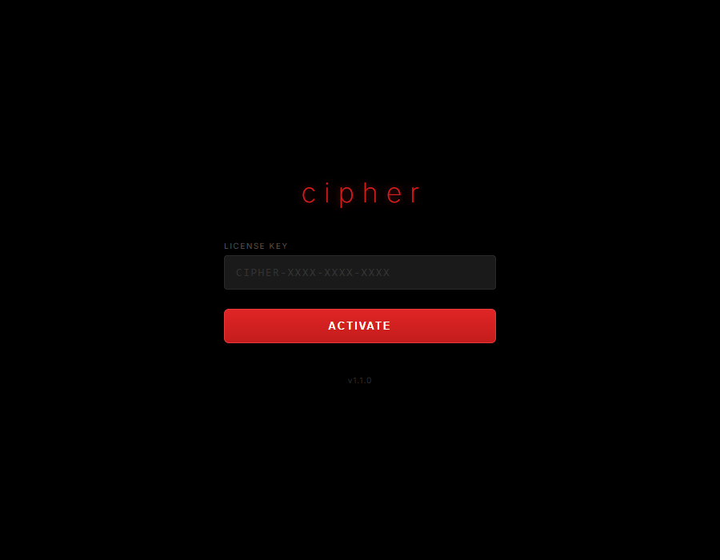

# Cipher HaxBall

Launcher de escritorio (Electron) para **haxball.com** que abre el juego, inyecta un *bridge* propio en la página y agrega asistencias de juego (apuntado, bot de IA, modo manual), todo detrás de un **sistema de licencias con Supabase**. Incluye un panel de administración web para gestionar las claves y una base de reversing del motor del juego.



## Stack

Electron, JavaScript (Node + navegador), Supabase (PostgreSQL con RPC y RLS), Playwright (para el bot original de línea de comandos) y electron-builder para el instalador.

## Arquitectura

```
┌──────────────── Electron ────────────────┐
│ main.js ── license.js ── interceptor.js   │     Supabase
│    │          │               │           │   ┌──────────────┐
│    │          │               │  inyecta  │   │ RPC          │
│  login UI   activate_license ─┼──────────────>│ activate_    │
│  (hwid)       (clave + HWID)   │           │   │ license      │
│                                ▼           │   │ verify_      │
│                   bridge.js en la página ──┼──>│ license      │
│                   de haxball.com           │   │ (RLS)        │
└────────────────────────────────────────────┘  └──────────────┘
```

- **`electron/main.js`** abre el cliente, gestiona la ventana y, al activar una licencia válida, carga el juego e inyecta el bridge.
- **`electron/license.js`** liga la licencia al equipo por **HWID** en la primera activación. Las credenciales nunca se commitean: la URL/clave de Supabase viven en `config.dev.js` / `config.prod.js` (gitignored), y el build empaqueta solo las de producción.
- **`electron/interceptor.js`** carga el bridge: en desarrollo usa el fuente sin ofuscar; en el `.exe` empaquetado usa la versión ofuscada (`bridge.enc.js`).
- **`src/inject/bridge.js`** es el núcleo técnico: corre dentro del IIFE del juego y reimplementa la física de HaxBall (portada del motor de HaxballGym) para predecir la trayectoria de la pelota a partir de las colisiones reales del estadio. De ahí salen el apuntado (`F8`) y el bot (`F9`).
- **`supabase/schema.sql`** define `licenses` (con estado `active`/`revoked` y HWID) y `activation_logs`, más las RPC `activate_license` y `verify_license`, que registran cada intento (activado, verificado, rechazado por HWID o clave inválida).
- **`admin/`** es un panel estático para crear, revocar y ver licencias. Apunta a dev por defecto y muestra un cartel rojo de `PRODUCTION` cuando se abre contra producción, para no editar por error.

## Dos entornos

Hay dos proyectos de Supabase, **dev** y **prod**, con el mismo esquema. El entorno del launcher se decide por `app.isPackaged`, no por algo que el cliente pueda tocar: desde el fuente (`npm start`) siempre es dev; el `.exe` distribuido siempre es prod. El binario de producción no contiene credenciales de dev (verificado extrayendo el asar).

## Desarrollo

```bash
cp electron/config.dev.example.js electron/config.dev.js   # completar claves dev
cp admin/config.example.js admin/config.js                 # claves service_role
# correr supabase/schema.sql en cada proyecto (dev y prod)

cd electron && npm install && npm start                     # corre contra dev
```

Controles en el juego: `Insert` muestra u oculta el panel, `F8` apuntado, `F9` bot de IA, `Ctrl` modo OP.

El procedimiento completo de desarrollo, build, auditoría del paquete y publicación está en [`docs/OPERACION.md`](docs/OPERACION.md). Las notas de reversing del motor están en [`docs/REVERSE_ENGINEERING.md`](docs/REVERSE_ENGINEERING.md) y el mapa de clases en [`docs/CLASS_MAP.md`](docs/CLASS_MAP.md).

## Estado

Versión **1.1.0** (septiembre de 2026). El instalador no se versiona en el repo. Es un proyecto personal de ingeniería inversa y automatización de un juego de navegador; usar asistencias en partidas con otras personas va contra los términos de HaxBall.

## Licencia

Código propietario. Todos los derechos reservados. La física deriva del motor de [HaxballGym](https://github.com/Wazarr94) (reversing de la comunidad); el juego HaxBall es de su autor.
